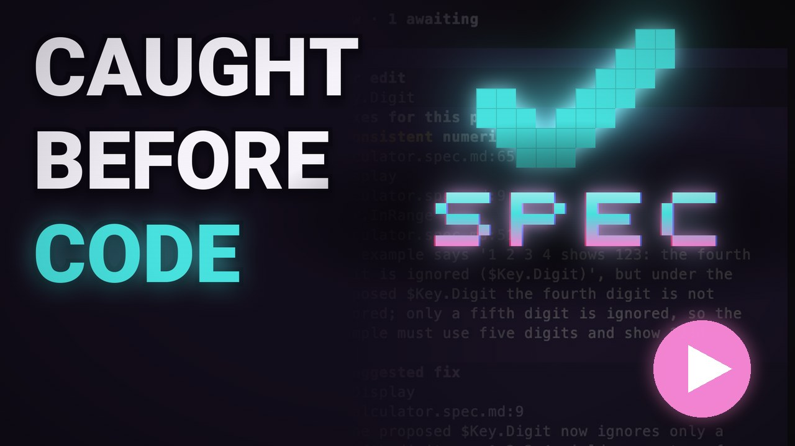
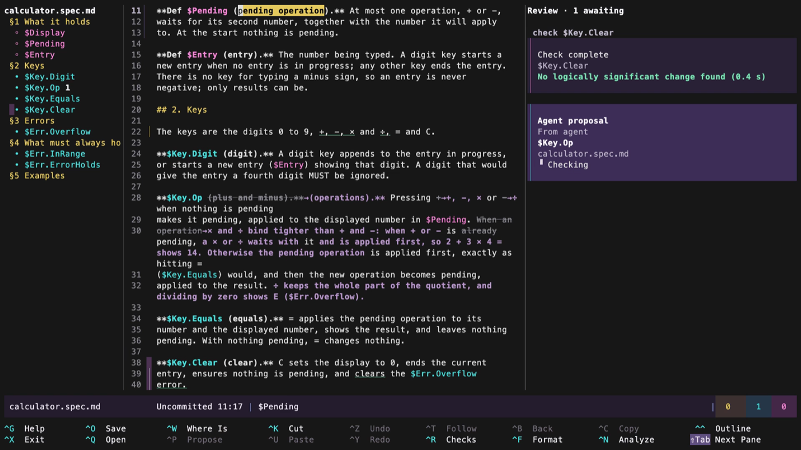
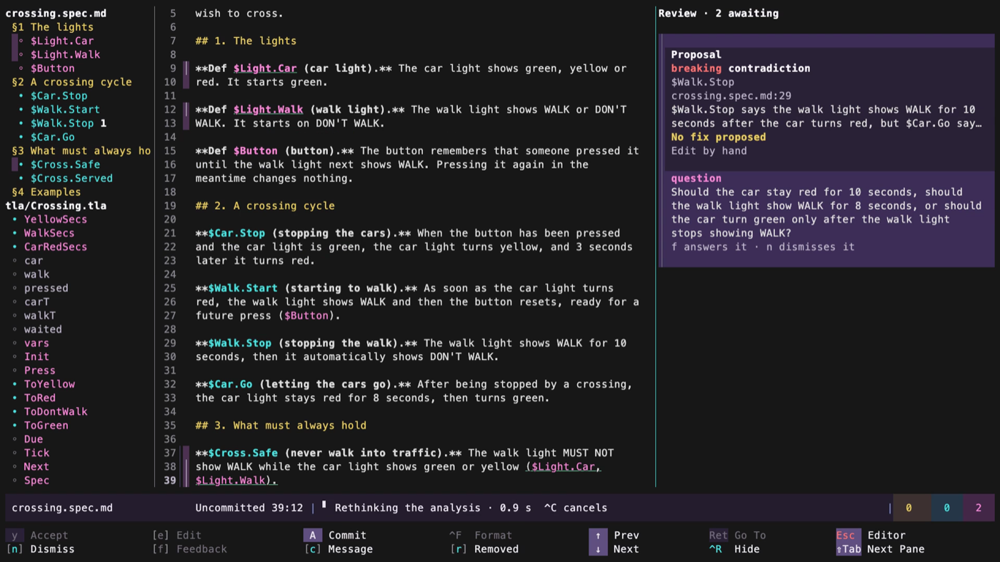
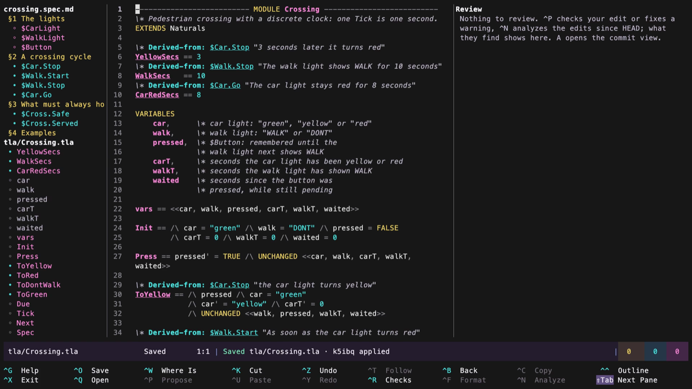

<!-- Copyright 2026 Christopher O'Connell -->
<!-- SPDX-License-Identifier: Apache-2.0 -->

# spec

`spec` is an editor for agentic coding, designed so that the human can focus on defining exactly _what_
they want their project to do, while the agent implements the _how_. Humans define their specifications
in plain markdown (with optional `$Anchor` definitions), and the `spec` editor performs logical inference
over the entire specification, similar to the way IDEs perform static and semantic checking on code. Make
a conflicting change in your design and `spec` will provide automated resolutions, like code completion,
but for concepts.

Once you have designed your system in natural language, `spec` also natively supports TLA+. Your agent
drafts formal descriptions from your spec (or you can write them by hand), and they are automatically
tied to, referenced against and checked against your plain descriptions, ensuring that the formal model of your
system is grounded directly in your spec.

`spec` is built so that every operation can be performed via the CLI or the UI. Proposals from agents and
scripts appear naturally in the UI and are checked alongside your own edits. Built-in accept/reject
workflows propagate both logical checks and your own messages back to your chosen coding agent. `spec` works
great with git: your documents remain plain text files, and the `spec` tool can orchestrate fine-grained
commits including spec-* commit trailers to provide detailed history and analysis of your project design.

Once you've designed an idea as a spec, just have your agent turn it into code. It will be fast and efficient,
and ground your code tests with the TLA in your spec.

## Vibe Start

Want to vibe try it out? Ask your agent to:

1. Please go install `go install github.com/jwriteclub/spec/cmd/spec@latest`
1. Please run `spec adopt` in my project
1. Tell your agent how you'd like to set it up [see supported providers](#supported-providers)
1. Run `spec ui` to start, and work together

The `spec` tool has a fully built-in set of instructions and init commands to teach your agent how to
collaboratively edit specs with you.

There are [detailed installation instructions](docs/install.md) and [complete setup instructions for manually configuring
a project for spec](docs/setup.md).

### Platform Support

`spec` works on macOS, Linux and Windows (-ish, it's not very well tested on Windows, yes). It
works well in any terminal with ASCII and 256 color support, however it will look even prettier (as
in the screenshots) on terminals with full color support. This has worked fine on most terminals
tested _except_ for Terminal.app on Mac, where it falls back to 256 color mode.

<table>
  <tr>
    <td width="33%"></td>
    <td width="33%"></td>
    <td width="33%"></td>
  </tr>
  <tr>
    <td align="center">An agent's change, checked instantly</td>
    <td align="center">A contradiction, and a question</td>
    <td align="center">TLA+ tied to the spec</td>
  </tr>
</table>

### Supported Providers

`spec` is designed to work with your existing Claude Code (via `claude -p`) or OpenAI Codex
(via `codex exec`). If you have one of these tools set up, pick it in settings and `spec` will check to
confirm that you have a supported version.

Alternatively, you can use OpenRouter ([setup video](https://youtu.be/tYKEDGLEhCs)), DeepSeek ([setup video](https://youtu.be/Jcp0z4ZBU-0)) or an OpenAI Compatible Provider.

In addition to inference models, `spec` supports decision models like Jev via OpenRouter, which provide
quick gate checks so you don't have to wait for full inference for logically insignificant changes.
I strongly recommend that you choose a decision model if you're doing serious editing with spec, it costs
pennies and saves a lot of time and tokens.

There are [detailed instructions on setting up Jev alongside your local agent as a provider, like Codex
or Claude Code](docs/providers.md).

Detailed provider results, based on our own testing over the last couple of weeks, are in [docs/models.md](docs/models.md).

## Quick Tips

Watch the getting started video: [Writing a spec: the calculator](https://youtu.be/DaKCvhbsXQ8).

Specs are very open-ended. They are intentionally not a formal grammar. You can bring in formal descriptions,
treating your spec like a flexible BNF. I recommend treating it as a series of simple paragraphs, each
describing one concept. After editing for a while, I find that I type `$Anchors` for invariants and definitions
by hand, but you don't have to. Write in plain language and ask your agent to make a proposal for adding
anchors. While not strictly necessary, anchors help linking formal descriptions (in TLA+) to your own
descriptions, and projects work best with a reasonable number of at least one per paragraph or definition.
How I split the work between writing by hand, my agent and TLA+: [How I write specs with an AI coding
agent](https://youtu.be/Bz5XlUndjfs).

The most powerful feature of specs is being able to define invariants and examples in plain natural language.
You can be extremely rigorous about this, but you can also just write a header "what should always be true" and
start listing items underneath. LLMs are excellent at finding conflicts and contradictions in these and helping
you to quickly converge on a rigorous description that you can understand. You can also just write down
examples of how you want the system to work. This is incredibly powerful because the most common scenario where
I find conflicts is when I carefully define a system and then paste in an example or user story which
subtly contradicts it.

Don't skip the formal step of having you or your model translate your plain specification into TLA+. The
process of fully modeling the system and checking for errors catches things that pure description misses,
particularly data races, unexpected paths to a state and so forth.
Watch an agent and a programmer add TLA+ to a spec together: [Adding formal verification with
TLA+](https://youtu.be/Eu1uuS2pJXw). The example has a deliberate bug, so you can see TLC catch it.

Finally, have your agent extend your tags all the way to your unit tests. I have a standing rule in many of
my projects now that every unit test must refer back to a specific `$Anchor` and/or `§1.2.3`. If a test can't
be related to one of these, then it might well be testing undesirable behavior (the only exception for this
is that in some languages I set up a parallel set of hygiene rules, things like specific tests that must be
done on I/O or exception handling rules so that every test remains grounded, even though I don't want to
muddy up my spec with lots of mechanical systems notes).

## Licence

Copyright 2026 Christopher O'Connell. Licensed under the Apache License, Version 2.0; see `LICENSE`
and `NOTICE`.
